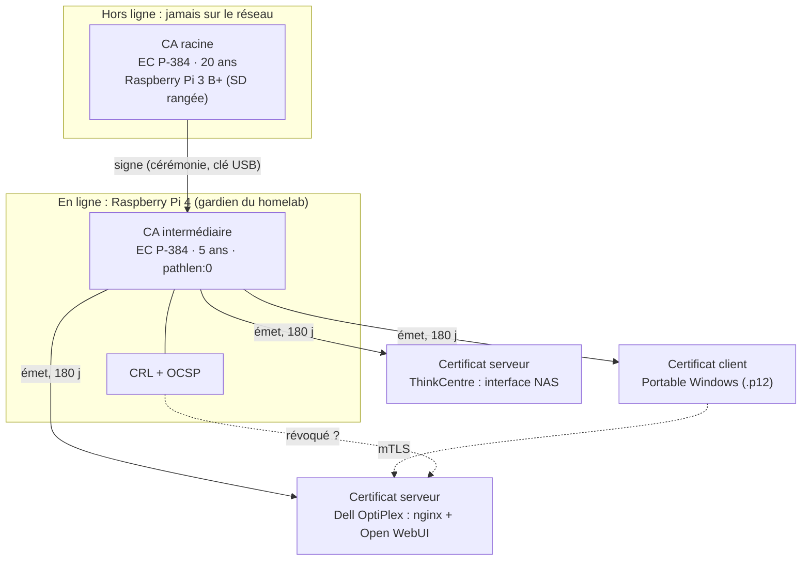

# Rapport technique : une PKI pour mon homelab

*Option A (socle) : OpenSSL, CA racine hors ligne, CA intermédiaire, certificats serveur/client, mTLS, révocation.*
*Structure calquée sur `Squelette_devoir.md` (définitions → architecture → choix → synthèse). Chaque `##` correspond à une diapositive.*

---

## 1. Pourquoi une PKI dans un homelab ?

Le homelab (Pi 4, Dell OptiPlex, Lenovo ThinkCentre, portable Windows) est protégé par un tunnel **WireGuard**, mais chaque service web interne (Open WebUI, Joplin Server, CasaOS…) parle encore en HTTP ou avec un certificat auto-signé que je dois accepter à la main. Une PKI interne apporte :

- **TLS de confiance** sur les interfaces internes, sans avertissement navigateur ;
- **mTLS** : le service n'accepte que les clients munis d'un certificat de ma PKI, sans mot de passe ;
- une base propre pour l'option B (ACME) et, plus tard, des certificats SSH.

**À retenir :** la PKI n'est pas indispensable au fonctionnement du homelab, c'est un gain en confiance, en authentification forte et en automatisation.

---

## 2. Définitions essentielles

| Notion | En une phrase |
|---|---|
| **Chiffrement asymétrique** | Paire clé publique (diffusable) / clé privée (secrète) : l'une chiffre ou vérifie, l'autre déchiffre ou signe. |
| **Certificat X.509** (RFC 5280) | Document signé qui lie une **identité** (nom DNS, utilisateur) à une **clé publique**, pour une période donnée. |
| **PKI** | Politiques, logiciels et autorités qui **émettent, distribuent, valident et révoquent** les certificats. |
| **CA racine** | Ancre de confiance, certificat auto-signé, clé **hors ligne**. Ne signe que les CA intermédiaires. |
| **CA intermédiaire** | Subordonnée à la racine, **en ligne**, émet les certificats du quotidien. Si elle est compromise, on la révoque sans changer de racine. |
| **Émission** | CSR → vérification → signature par la CA → déploiement de la chaîne complète. |
| **Révocation** | Invalidation avant l'échéance (clé compromise…), publiée par **CRL** ou **OCSP**. |

---

## 3. Architecture : qui détient quelle clé ?

| Machine | Rôle PKI | Justification |
|---|---|---|
| **Raspberry Pi 3 B+** (aujourd'hui « hors chaîne ») | **CA racine hors ligne** : carte SD chiffrée, rangée entre deux cérémonies | Matériel inutilisé et réellement isolable. Pas d'horloge matérielle : régler la date à la main avant la cérémonie. |
| **Raspberry Pi 4** | **CA intermédiaire** + CRL/OCSP | Toujours allumé. OpenSSL n'est pas un démon : la CA elle-même n'ouvre aucun port, seule la surface de l'hôte compte (SSH par clé, pare-feu). |
| **Dell OptiPlex 7010** | Consommateur : **nginx en mTLS** devant Open WebUI | C'est le « service réel » de la démo. |
| **Lenovo ThinkCentre** | Consommateur : certificat serveur du NAS | Pas d'hébergement de CA sur la machine qui contient les données. |
| **Portable Windows** | Client mTLS (`.p12`) et poste d'administration | Repli possible pour la racine (conteneur chiffré), mais **moins sûr** : un portable connecté n'est pas « hors ligne ». |

Nommage : `*.home.arpa` (RFC 8375, réservé à l'usage domestique) plutôt que `.local`, réservé au mDNS (RFC 6762). Le DNS interne est servi par Pi-hole.

---

## 4. Périmètre : options A / B / C

| Option | Contenu | Statut ici |
|---|---|---|
| **A, socle** | OpenSSL : racine offline + intermédiaire + certificats serveur/client + mTLS + CRL/OCSP | **Fait et testé** (`scripts/99-demo-test.sh`) |
| **B, bonus** | step-ca + ACME + reverse proxy (renouvellement automatique) | Évolution naturelle pour le homelab, non réalisée |
| **C, bonus** | S/MIME vs GPG (toile de confiance) | Culture sécurité, non réalisée |

**Ordre retenu :** A d'abord (comprendre chaque étape à la main), B pour industrialiser, C si le temps le permet.

---

## 5. Choix cryptographiques justifiés

| Paramètre | Choix | Pourquoi |
|---|---|---|
| Algorithme CA | **EC P-384** | ≈ 192 bits de sécurité (NIST SP 800-57) ; clés courtes, signatures rapides sur un Pi ; recommandé par le sujet. |
| Algorithme feuilles | **EC P-256** | ≈ 128 bits, suffisant pour des certificats de 6 mois, handshake léger ; compatible navigateurs et nginx. |
| Alternative écartée | RSA 3072 | Même niveau de sécurité que P-256 mais clés et signatures beaucoup plus lourdes ; aucun besoin de compatibilité héritée ici. |
| Hachage | **SHA-384** (CA) / **SHA-256** (feuilles) | SHA-1 proscrit (consigne du kick-off, « SHA-256 minimum »). Hachage assorti à la courbe. |
| Durée racine | **20 ans** | Hors ligne, rarement exposée ; son remplacement est coûteux (redistribution partout). |
| Durée intermédiaire | **5 ans** | Exposée en ligne : cycle de rotation raisonnable. |
| Durée feuilles | **180 jours** | Sous le plafond de 200 jours indiqué au kick-off (TLS public, 100 jours dès mars 2027). Une courte durée limite la fenêtre d'exposition et rend la révocation moins critique. |
| Extensions | `CA:TRUE, pathlen:0` ; `keyUsage` ; `serverAuth`/`clientAuth` ; **SAN** | `pathlen:0` empêche l'intermédiaire de créer une sous-CA ; les clients valident le SAN, pas le CN. |

---

## 6. Gestion des clés : stockage, rotation, révocation

- **Stockage** : clés des CA chiffrées en AES-256 (passphrase), `chmod 400`, jamais dans Git (`.gitignore`). Racine sur support déconnecté, deux copies chiffrées. Clé serveur `chmod 600` (nginx doit démarrer sans saisie).
- **Génération** : toujours par OpenSSL (CSPRNG de l'OS). Je ne fournis jamais moi-même un paramètre de génération.
- **Rotation** : feuilles renouvelées avant 30 j d'échéance (`06-check-expiry.sh` + cron), intermédiaire avant l'an 4, racine planifiée à l'an 18.
- **Révocation** : voir §8. Une clé suspectée compromise est révoquée immédiatement, puis le certificat est réémis avec une **nouvelle** clé.

### Étude de cas : compromission d'eMudhra (octobre 2026)
D'après le rapport d'incident fourni : un générateur aléatoire défaillant a produit des clés **ECDSA P-384** dont la valeur privée était inférieure à 256. La clé privée se déduisait de la clé publique en une fraction de seconde. **8 CA intermédiaires** ont dû être révoquées et l'AC s'est retirée du marché TLS.

Leçons appliquées ici :
1. Une courbe solide ne protège pas contre une **mauvaise source d'aléa** : clés générées par le CSPRNG d'OpenSSL, jamais « à la main » ; sur le Pi, vérifier la source d'entropie.
2. La confiance se retire **côté clients** : truststores des applications (`certifi` Python, Java, images Docker anciennes) à mettre à jour, d'où l'inventaire de mes truststores.
3. La révocation ne vaut que si le client **vérifie** CRL/OCSP : d'où `ssl_crl` côté nginx et le test de refus.

---

## 7. Mise en œuvre

| Étape | Script | Machine |
|---|---|---|
| Racine (P-384, 20 ans) + CRL | `00-init-root.sh` | racine hors ligne |
| Clé + CSR intermédiaire | `01-init-intermediate.sh` | Pi 4 |
| Signature de l'intermédiaire (5 ans) | `02-root-signs-intermediate.sh` | racine hors ligne |
| Chaîne, 1re CRL, bundle | `02b-intermediate-finalize.sh` | Pi 4 |
| Certificat serveur (SAN, 180 j) | `03-issue-server.sh` | Pi 4 → OptiPlex |
| Certificat client + `.p12` | `04-issue-client.sh` | Pi 4 → portable |
| Révocation + CRL | `05-revoke.sh` | Pi 4 |
| Suivi des échéances | `06-check-expiry.sh` (cron) | Pi 4 |
| Service mTLS | `nginx/app.home.arpa.conf` | OptiPlex |

---

## 8. Révocation : CRL ou OCSP ?

| | **CRL** | **OCSP** |
|---|---|---|
| Principe | Liste signée téléchargée, vérifiée localement | Requête de statut en temps réel |
| Avantages | Simple, fonctionne hors ligne, **nativement lue par nginx** (`ssl_crl`) | Statut immédiat, réponse légère |
| Inconvénients | Mise à jour différée, fichier qui grossit | Répondeur à maintenir en ligne |
| Choix | **Mécanisme principal** (la CRL racine et la CRL intermédiaire dans un même bundle) | Démontré avec `openssl ocsp` |

**Procédure :** l'opératrice exécute `05-revoke.sh <cert> <motif>` → ligne `R` dans `index.txt` → nouvelle CRL → copie du bundle sur le service → `nginx -s reload` (nginx ne relit la CRL qu'au rechargement).

---

## 9. Preuves : résultats du test automatisé

Exécuté le 5 novembre 2026 sur le portable (OpenSSL 3.2.3, Git Bash), `bash scripts/99-demo-test.sh` :

| Vérification | Résultat |
|---|---|
| Chaîne racine → intermédiaire → serveur valide ; `pathlen:0` | PASS |
| Connexion **sans** certificat client | refusée : `alert certificate required` |
| Connexion avec le certificat d'alice / de bob (valides) | acceptée |
| Après révocation d'alice : connexion d'alice | **refusée : `alert certificate revoked`** |
| Après révocation d'alice : connexion de bob | toujours acceptée |
| OCSP : alice / bob | `revoked` / `good` |
| Supervision : aucun certificat à renouveler sous 30 j | PASS |

**Limites honnêtes :**
- Le « service » du test est `openssl s_server`, pas nginx : la logique de vérification (chaîne + CRL) est la même bibliothèque, mais la **config nginx fournie n'a pas encore été exécutée**. À valider sur le Dell avant la démo (`nginx -t`, `curl` avec/sans certificat, avant/après `reload`).
- Test réalisé sur une seule machine ; le déploiement multi-machines (Pi 3 B+, Pi 4, OptiPlex) reste à faire.
- `openssl s_server` ne charge qu'**une** CRL par fichier : le test utilise un dossier de CRL indexées par hash ; nginx, lui, lit le bundle de CRL tel quel.

---

## 10. Synthèse

| Livrable du sujet | Où | État |
|---|---|---|
| Schéma d'architecture + mini CP/CPS | §3 ; `docs/CP-CPS.md` | fait |
| Infrastructure : racine, intermédiaire, certificats, révocation | `scripts/` | fait, testé |
| Service sécurisé (mTLS) | `nginx/app.home.arpa.conf` ; test `s_server` | test OK ; nginx à valider |
| Test de révocation | §9 | fait |
| Rapport justifiant les choix cryptographiques | §5, §6 | fait |
| Dépôt GitHub + README | ce dépôt (privé, accès au formateur) | à pousser |

| Compétence | Preuve |
|---|---|
| BC01·C3 sécuriser l'infrastructure | clés chiffrées, `chmod`, racine isolée, durcissement de l'hôte PKI |
| BC02·C5 concevoir | §3, §5 |
| BC02·C6 mettre en production | §7, §9 |
| BC03·C9 politique de sécurité | `docs/CP-CPS.md` |

---

## Annexe : plan du diaporama (10-15 min, démo à l'appui)

| # | Diapositive | Durée |
|---|---|---|
| 1 | Titre + problème du homelab (§1) | 0:45 |
| 2 | Définitions en une image (§2) | 1:15 |
| 3 | Architecture et placement des clés (§3) | 2:00 |
| 4 | Choix cryptographiques (§5) | 1:30 |
| 5 | Gestion des clés + cas eMudhra (§6) | 1:30 |
| 6 | Mise en œuvre, les 6 scripts (§7) | 1:00 |
| 7 | **Démo** : avec/sans certificat, révocation en direct (§9) | 3:00 |
| 8 | CRL vs OCSP (§8) | 1:00 |
| 9 | Limites, options B/C, suite (§4, §9) | 1:00 |
| 10 | Conclusion + livrables/compétences (§10) | 0:45 |
